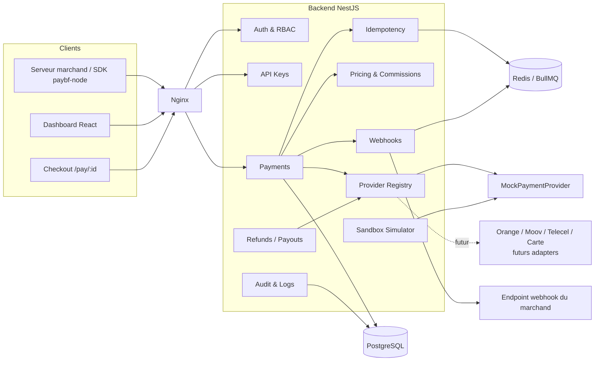

# PayBF — Dossier de conception (Phase 0)

> Environnement **SANDBOX uniquement**. Aucun fonds réel, aucun agrément revendiqué. L'architecture prépare l'intégration future de prestataires de paiement légalement autorisés (BCEAO/UEMOA).

---

## 1. Architecture

**Style : monolithe modulaire NestJS** (un seul déploiement, modules à frontières strictes) plutôt que des microservices. Pour un MVP, c'est plus simple à tester et à opérer, et chaque module peut être extrait plus tard.

| Couche | Choix | Rôle |
|---|---|---|
| API | NestJS + TypeScript, REST `/api/v1`, OpenAPI | API publique et API dashboard |
| Données | PostgreSQL + Prisma | Source de vérité, montants en entiers (XOF, pas de décimales) |
| Cache / files | Redis + BullMQ | Rate limiting, idempotence (verrou), file de webhooks avec retry |
| Frontend | React + Vite + Tailwind | Dashboard, admin, checkout hébergé, docs |
| Edge | Nginx | TLS, reverse proxy, en-têtes de sécurité |
| Providers | Interface `PaymentProvider` | Mock aujourd'hui, providers réels demain |

**Principes**
- Deux plans d'authentification distincts : **clés API** (serveur du marchand → API publique) et **JWT** (humains → dashboard).
- Montants en **entiers** (unité mineure). XOF n'a pas de centimes, donc `10000` = 10 000 FCFA.
- Machine à états de paiement stricte, transitions validées côté domaine.
- Toute écriture financière est dans une transaction DB et produit un événement (outbox) → webhooks.
- Isolation multi-marchands par `merchant_id` sur toutes les tables, appliquée dans un garde + filtre Prisma central, et testée.

## 2. Diagramme des composants



## 3. Arborescence

```
paybf/
├── docker-compose.yml  .env.example  README.md
├── nginx/nginx.conf
├── backend/
│   ├── Dockerfile  package.json  tsconfig.json
│   ├── prisma/ schema.prisma  migrations/  seed.ts
│   ├── src/
│   │   ├── main.ts  app.module.ts
│   │   ├── common/  (guards, filters, interceptors, correlation-id, errors, pagination, money)
│   │   ├── config/  (env validation)
│   │   ├── modules/
│   │   │   ├── auth/  users/  merchants/  applications/
│   │   │   ├── api-keys/  customers/
│   │   │   ├── payments/  transactions/  refunds/  payouts/
│   │   │   ├── idempotency/  pricing/  commissions/
│   │   │   ├── webhooks/  (endpoints, deliveries, signer, dispatcher, worker)
│   │   │   ├── providers/  (payment-provider.interface.ts, registry, mock/, orange-money/ …)
│   │   │   ├── sandbox/  admin/  audit/  observability/  health/
│   │   └── …
│   └── test/ (unit, integration, e2e)
├── frontend/
│   ├── Dockerfile  vite.config.ts  tailwind.config.ts
│   └── src/ (app/, features/{overview,payments,customers,refunds,webhooks,api-keys,logs,docs,admin,checkout}, components/ui, lib/api, theme/)
├── sdk/paybf-node/  (src/, tests/, README)
└── examples/telemed-demo/  (petit serveur + front)
```

## 4. Schéma PostgreSQL (résumé des entités)

Conventions : `id` préfixé (`txn_`, `cus_`, `evt_`…), `created_at/updated_at`, `merchant_id` indexé partout, montants `BIGINT`, enums Postgres.

| Table | Colonnes clés | Contraintes / index |
|---|---|---|
| **User** | id, email, password_hash (Argon2id), role (PLATFORM_ADMIN, OWNER, ADMIN, DEVELOPER, VIEWER), merchant_id? | unique(email) |
| **RefreshToken** | user_id, token_hash, expires_at, revoked_at | index(user_id) |
| **Merchant** | id, name, logo_url, status, pricing_plan_id, plan_tier (FREE/STARTER/BUSINESS/ENTERPRISE), kyc_status | unique(slug) |
| **Application** | id, merchant_id, name, environment (TEST/LIVE) | index(merchant_id) |
| **ApiKey** | id, application_id, merchant_id, type (PUBLISHABLE/SECRET), prefix, hash (SHA-256 du secret), last4, environment, permissions[], last_used_at, revoked_at, rotated_from | unique(hash), index(prefix) |
| **Customer** | id, merchant_id, name, email, phone | unique(merchant_id, email) |
| **PaymentMethod** | id, merchant_id, customer_id?, type (MOBILE_MONEY/CARD), provider_code, msisdn_masked, token? | jamais de PIN ni PAN complet |
| **Payment** | id (`txn_`), merchant_id, application_id, customer_id, amount, currency, status, description, provider_code, method_type, success_url, cancel_url, idempotency_key, metadata jsonb, expires_at | unique(merchant_id, idempotency_key), index(merchant_id, status, created_at) |
| **Transaction** | id, payment_id, merchant_id, kind (PAYMENT/REFUND/PAYOUT/FEE), amount, status, balance_effect | ledger en écriture seule |
| **Refund** | id, payment_id, merchant_id, amount, reason, status | CHECK : somme des remboursements ≤ montant du paiement |
| **Payout** | id, merchant_id, amount, destination, status | |
| **WebhookEndpoint** | id, merchant_id, url, secret_enc, events[], active | |
| **WebhookDelivery** | id, endpoint_id, event_id, event_type, payload, attempt, status, response_code, next_retry_at, signature | unique(endpoint_id, event_id) = anti-doublon |
| **Commission** | id, payment_id, merchant_id, rate_applied, fixed_fee, amount, net_amount | |
| **PricingPlan** | id, name, model (PERCENT/FIXED/PERCENT_PLUS_FIXED/CUSTOM), percent_bps, fixed_fee, min_fee, max_fee, monthly_fee, tx_limit | |
| **AuditLog** | id, merchant_id?, actor_id, actor_type, action, resource, ip, user_agent, correlation_id, diff jsonb | append-only |
| **Provider** | id, code, name, enabled, supports (jsonb), config_enc | |
| **ProviderTransaction** | id, payment_id, provider_code, provider_ref, raw_status, request_log, response_log, error_code, latency_ms | alimente la page Developer Logs |
| **IdempotencyRecord** | merchant_id, key, request_hash, response_snapshot, status | unique(merchant_id, key), TTL 24 h |

Calcul de commission en **basis points** : `commission = round(amount × bps / 10000) + fixe`, net = amount − commission. Exemple : 100 000 × 150 bps = 1 500, net 98 500.

## 5. Endpoints

**Public (clé `sk_test_…`)** — `/api/v1`
- `POST /payments` · `GET /payments/:id` · `POST /payments/:id/cancel`
- `POST /refunds` · `GET /refunds/:id`
- `GET /transactions`
- `POST /customers` · `GET /customers/:id`
- `POST /webhooks` · `GET /webhooks` (+ `POST /webhooks/deliveries/:id/replay`)
- `POST /payouts`
- `GET /providers` · `GET /health` (hors versionnement)

**Checkout (token de session de paiement, pas de clé secrète)**
- `GET /checkout/:txn` · `POST /checkout/:txn/pay` · `GET /checkout/:txn/status`

**Dashboard (JWT)** — `/api/v1/dashboard/*` : auth (register, login, refresh, logout), overview, payments, customers, refunds, webhooks, api-keys (create/rotate/revoke), logs, settings, team.

**Sandbox (JWT)** — `POST /sandbox/payments/:id/simulate` (`success|failed|timeout|pending|refund`).

**Admin plateforme (JWT PLATFORM_ADMIN)** — `/api/v1/admin/*` : merchants, transactions, volume, commissions, providers, webhooks, errors, usage, logs, pricing.

## 6. Flux de paiement

1. Le serveur marchand appelle `POST /payments` avec `Authorization: Bearer sk_test_…` et `Idempotency-Key`.
2. Guard API key : hash → clé → merchant + environnement + permissions. Rate limit Redis.
3. **Idempotence** : verrou Redis `SET NX` sur (merchant, key). Même clé + même corps → renvoie la réponse d'origine (une seule transaction). Même clé + corps différent → `409 idempotency_key_reuse`. Contrainte unique en base comme filet de sécurité.
4. Validation stricte (DTO), création `Payment(PENDING)`, calcul de commission, événement `payment.created`.
5. Réponse `{ id, status: PENDING, payment_url }`.
6. Le client ouvre `/pay/:txn`, choisit le moyen de paiement, saisit son numéro.
7. `ProviderRegistry.get(provider).createPayment()` : en sandbox, `MockPaymentProvider` applique les règles de numéro (`70000001` → SUCCESS, `…02` → FAILED, `…03` → PENDING).
8. Transition d'état + écriture `ProviderTransaction` + ledger + `payment.success|failed|pending`.
9. Dispatcher de webhooks : enregistre une `WebhookDelivery`, la file BullMQ envoie le POST signé.
10. Redirection vers `success_url` ou `cancel_url`.

**États** : `PENDING → SUCCESS | FAILED | CANCELLED | EXPIRED` ; `SUCCESS → REFUNDED | PARTIALLY_REFUNDED`. Transitions illégales rejetées.

**Webhooks** : en-têtes `PayBF-Signature: t=<timestamp>,v1=<HMAC-SHA256(secret, t + "." + body)>`, tolérance de 5 min contre le rejeu, retry avec backoff exponentiel (30 s, 2 min, 10 min, 1 h, 6 h, puis échec définitif), `event_id` unique pour la déduplication côté marchand, historique et replay manuel.

## 7. Stratégie de sécurité

- **Mots de passe** : Argon2id. **JWT** courts (15 min) + refresh token rotatif stocké haché, révocable.
- **Clés API** : secret affiché une seule fois, stocké en SHA-256 (+ préfixe et 4 derniers caractères). Rotation avec période de chevauchement, révocation immédiate, `last_used_at`, permissions par clé, séparation test/live.
- **RBAC** : rôles plateforme et marchand, garde par permission.
- **Isolation** : `merchant_id` injecté depuis le contexte d'authentification, jamais depuis le client ; tests d'accès croisé obligatoires.
- **Validation** : `class-validator` en whitelist stricte, Prisma paramétré (pas de SQL brut), échappement/CSP côté front contre XSS, Helmet.
- **Rate limiting** Redis par clé API et par IP ; CORS en liste blanche.
- **Secrets** : variables d'environnement, validées au démarrage ; secrets webhook et config provider chiffrés (AES-256-GCM) ; rien dans Git.
- **Audit** : logs append-only de toutes les actions sensibles.
- **Données** : aucun PIN/mot de passe Mobile Money, pas de PAN en clair, numéros de téléphone masqués dans les logs.
- **Préparé, non implémenté** : KYC, AML, scoring de fraude, plafonds de transaction (hooks et champs prévus, aucune revendication de conformité).

## 8. Stratégie multi-provider

```ts
interface PaymentProvider {
  readonly code: string;
  readonly capabilities: ProviderCapabilities;
  createPayment(input: CreateProviderPayment): Promise<ProviderPaymentResult>;
  verifyPayment(ref: string): Promise<ProviderPaymentResult>;
  getPaymentStatus(ref: string): Promise<ProviderStatus>;
  refundPayment(input: ProviderRefundInput): Promise<ProviderRefundResult>;
  payout(input: ProviderPayoutInput): Promise<ProviderPayoutResult>;
}
```

- **Strategy** : le `ProviderRegistry` résout le provider par code (injection NestJS avec token multi-provider).
- **Adapter** : chaque provider réel traduit son API propriétaire vers les types neutres de PayBF et normalise les statuts et erreurs.
- Ajouter `OrangeMoneyProvider` = un nouveau dossier + un enregistrement, **sans toucher au cœur**.
- Webhooks entrants des providers : endpoint dédié par provider avec vérification de signature propre à chacun.
- Résilience prévue : timeouts, circuit breaker, routage/fallback par provider, réconciliation périodique.
- Le jour venu, ces adapters ne se brancheront que sur des prestataires de paiement agréés ; PayBF ne détient pas les fonds.

## 9. Modèle économique

| Plan | Frais mensuels | Commission | Limites |
|---|---|---|---|
| FREE | 0 | % standard | volume et appels limités |
| STARTER | forfait bas | % réduit | limites élevées |
| BUSINESS | forfait moyen | % + fixe, tarifs négociables | webhooks avancés, support |
| ENTERPRISE | sur devis | tarif personnalisé | SLA, sous-comptes |

Sources de revenus prévues : commission transactionnelle, abonnement, fonctionnalités payantes (payouts, API premium, rétention de logs), grands comptes. Dans le MVP, tout est **calculé et affiché, jamais facturé**. Les tarifs sont des paramètres modifiables par l'admin (`PricingPlan`), pas du code.

## 10. Roadmap et phases d'implémentation

| Phase | Contenu |
|---|---|
| 1 | Squelette monorepo, Docker Compose, Prisma, config, health, CI de base |
| 2 | Auth (JWT, refresh, Argon2), RBAC, marchands, applications, audit |
| 3 | Clés API, guard, rate limiting, isolation + tests |
| 4 | Providers (interface, registry, Mock), paiements, idempotence, machine à états |
| 5 | Remboursements, payouts, commissions et tarification |
| 6 | Webhooks (signature, retry, replay, déduplication) |
| 7 | Frontend : design system, dashboard, checkout, sandbox, logs |
| 8 | Admin plateforme, observabilité, graphiques |
| 9 | SDK `paybf-node`, documentation interactive, TeleMed Demo |
| 10 | Tests E2E, durcissement, README, vérification Docker complète |

Après chaque phase : compilation, tests, migrations, Docker, résumé.

**MVP** : auth, dashboard marchand, clés API, paiements, checkout, sandbox, webhooks, remboursements, commissions, documentation, SDK Node.
**V2** : vrais providers agréés, Mobile Money réel, cartes, payouts réels, abonnements, marketplace, sous-comptes, KYC, fraude, monitoring avancé.
**V3** : autres pays UEMOA, multi-devises, SDK PHP/Python, infrastructure à grande échelle.

---

## Décisions à confirmer avant de coder

1. **Monolithe modulaire** NestJS (recommandé) plutôt que microservices.
2. **BullMQ sur Redis** pour la file de webhooks (plutôt qu'un worker maison).
3. **Monorepo** simple (npm workspaces) pour backend, frontend, SDK, démo.
4. **Graphiques** : Recharts.
5. **Langue** de l'interface et de la doc : français par défaut, anglais pour l'API Reference et le code.
6. **Nom** : « PayBF » reste provisoire ; à vérifier (marque, domaine) avant toute communication publique.
